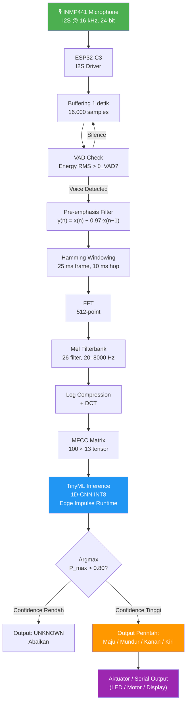

# Laporan Rancangan Sistem Proyek Akhir
## **Edge Voice Command Recognition Berbasis ESP32-C3 dan TinyML**

> [!IMPORTANT]
> Laporan ini disusun sebagai syarat pemenuhan tugas proyek akhir mata kuliah **Instrumentasi Cerdas**.
> Setiap anggota kelompok wajib mengumpulkan laporan ini secara individu melalui **SIMASTER**.

---

## 1. Judul

**Sistem Pengenalan Perintah Suara Berbasis *Edge AI* (TinyML) Menggunakan Mikrofon INMP441 dan ESP32-C3 sebagai Kendali Navigasi Robot**

---

## 2. Tujuan Alat / Sistem

Sistem ini dirancang dengan tujuan:

1. **Membangun** sistem pengenalan perintah suara (*voice command recognition*) yang berjalan sepenuhnya di *edge device* (ESP32-C3) tanpa memerlukan koneksi internet atau server eksternal.
2. **Mengklasifikasikan** 4 kelas perintah suara: `"Maju"`, `"Mundur"`, `"Kanan"`, `"Kiri"`, dan 1 kelas latar belakang: `"Noise/Silence"`.
3. **Mengevaluasi** performa sistem TinyML di perangkat *resource-constrained* (RAM terbatas ~400 KB) dibandingkan dengan sistem pengenalan suara berbasis *cloud* (Google Assistant / Speech Recognition API pada smartphone).
4. **Menerapkan** konsep rantai instrumentasi cerdas secara penuh:

$$\text{Sensor (Mic INMP441)} \xrightarrow{\text{Akuisisi}} \text{Signal Processing (Denoising, MFCC)} \xrightarrow{\text{Model}} \text{Klasifikasi (TinyML CNN)}$$

---

## 3. Sensor yang Dipakai

### 3.1 Sensor Utama: Mikrofon Digital INMP441

| Parameter | Spesifikasi |
| :--- | :--- |
| **Tipe Antarmuka** | I2S (*Inter-IC Sound*) Digital |
| **Frekuensi Sampling** | 16.000 Hz (16 kHz) |
| **Resolusi ADC** | 24-bit |
| **Rentang Frekuensi** | 60 Hz – 15 kHz |
| **SNR** (*Signal-to-Noise Ratio*) | 61 dBFS |
| **Sensitivitas** | −26 dBFS |
| **Tegangan Operasi** | 1.8 V – 3.3 V |
| **Koneksi ke ESP32-C3** | GPIO: SCK, WS (LRCK), SD |
| **Harga Estimasi** | ~Rp 15.000 – Rp 20.000 |

### 3.2 Mikrokontroler: ESP32-C3

| Parameter | Spesifikasi |
| :--- | :--- |
| **Arsitektur CPU** | RISC-V 32-bit, single-core, 160 MHz |
| **SRAM** | 400 KB |
| **Flash** | 4 MB |
| **Periferal** | I2S, SPI, I2C, UART, Wi-Fi, BLE |
| **Peran dalam Sistem** | *Data Acquisition* + *TinyML Inference* |

### 3.3 Pembanding (Referensi)
- **Google Speech Recognition API** pada smartphone Android sebagai *baseline* akurasi sistem berbasis *cloud*.

---

## 4. Preprocessing (Pra-pemrosesan Sinyal)

Pra-pemrosesan dilakukan untuk membersihkan sinyal audio mentah dari mikrofon sebelum diekstraksi fiturnya. Terdapat 4 tahap utama:

```
[Raw Audio I2S 16kHz]
        |
        v
[1. Framing & Windowing]
        |
        v
[2. DC Offset Removal & Normalisasi Amplitudo]
        |
        v
[3. Pre-emphasis Filter]
        |
        v
[4. Voice Activity Detection (VAD)]
        |
        v
[Frame Siap untuk Ekstraksi Fitur]
```

### 4.1 Framing & Windowing
- Sinyal audio dibagi menjadi **frame pendek** berdurasi **25 ms** dengan **overlap 10 ms** (meluncur setiap 10 ms / *hop size*).
- Setiap frame dikenakan **Hamming Window** untuk mengurangi efek *spectral leakage* di tepi frame:

$$w(n) = 0.54 - 0.46 \cos\!\left(\frac{2\pi n}{N-1}\right), \quad n = 0, 1, \ldots, N-1$$

### 4.2 DC Offset Removal & Normalisasi
- Komponen DC dihilangkan dengan mengurangkan nilai rata-rata sinyal tiap frame:
$$x'(n) = x(n) - \bar{x}$$
- Amplitudo dinormalisasi ke rentang $[-1, 1]$ untuk menyamakan level antar rekaman.

### 4.3 Pre-emphasis Filter
- Filter *high-pass* orde pertama untuk menyeimbangkan spektrum dan meningkatkan *high-frequency component* suara manusia:
$$y(n) = x(n) - \alpha \cdot x(n-1), \quad \alpha = 0.97$$

### 4.4 Voice Activity Detection (VAD)
- Deteksi kehadiran suara menggunakan ambang energi (*energy thresholding*) RMS frame:
$$E_{\text{rms}} = \sqrt{\frac{1}{N}\sum_{n=0}^{N-1} y(n)^2}$$
- Frame dengan $E_{\text{rms}} < \theta_{\text{VAD}}$ diklasifikasikan sebagai *silence* dan tidak diproses lebih lanjut.

---

## 5. Ekstraksi Fitur

Representasi fitur yang dipilih adalah **Mel-Frequency Cepstral Coefficients (MFCC)** yang dikonversi menjadi **representasi 2D (spektrogram)** sebagai input model CNN.

### 5.1 Pipeline Ekstraksi Fitur MFCC

```
[Windowed Frame]
      |
      v
[FFT (Fast Fourier Transform)]
      |
      v
[Mel Filterbank (26 filter, 20 Hz – 8000 Hz)]
      |
      v
[Log Compression: ln(·)]
      |
      v
[DCT (Discrete Cosine Transform)]
      |
      v
[MFCC Koefisien ke-1 s.d. ke-13]
      |
      v
[Stacking → Matriks 2D: (n_frames × 13)]
```

### 5.2 Parameter MFCC

| Parameter | Nilai |
| :--- | :--- |
| **Frekuensi Sampling** | 16.000 Hz |
| **Durasi Jendela Input** | 1 detik |
| **Jumlah Frame per Jendela** | ~100 frame |
| **Jumlah Mel Filter** | 26 |
| **Jumlah Koefisien MFCC** | 13 (C1–C13) |
| **Ukuran Matriks Fitur Final** | 100 × 13 = 1.300 nilai |
| **Format Input Model** | Tensor 2D grayscale (100, 13, 1) |

### 5.3 Augmentasi Data (saat Training)
Untuk memperbesar variasi data latih dan meningkatkan ketahanan model:
- **Time Shifting:** Menggeser sinyal ±100 ms secara acak.
- **Gaussian Noise Injection:** Menambahkan noise putih kecil ($\sigma = 0.005$).
- **Pitch Shifting:** Mengubah nada ±1–2 semitone.

---

## 6. Machine Learning / AI

### 6.1 Arsitektur Model: 1D-CNN (TinyML)

Model yang dipilih adalah **Convolutional Neural Network 1D** yang dioptimasi untuk ESP32-C3 melalui platform **Edge Impulse**.

```
Input (100 × 13 MFCC)
        |
  [Conv1D, 8 filter, kernel=3, ReLU]
        |
  [MaxPooling1D, pool=2]
        |
  [Conv1D, 16 filter, kernel=3, ReLU]
        |
  [MaxPooling1D, pool=2]
        |
  [Flatten]
        |
  [Dense 32, ReLU]
        |
  [Dropout 0.25]
        |
  [Dense 5, Softmax]
        |
Output: P("Maju"), P("Mundur"), P("Kanan"), P("Kiri"), P("Noise")
```

### 6.2 Alasan Pemilihan Model
1. **Ringan:** Estimasi ukuran model setelah kuantisasi INT8 ~25–40 KB (jauh di bawah 400 KB SRAM ESP32-C3).
2. **Cocok untuk Pola Temporal 1D:** Koefisien MFCC memiliki ketergantungan temporal yang baik ditangkap oleh Conv1D.
3. **Latensi Rendah:** Inferensi tunggal ~50–100 ms pada ESP32-C3.

### 6.3 Strategi Training & Validasi

> [!IMPORTANT]
> Strategi validasi menggunakan **Subject-Wise Split** untuk mencegah *data leakage* antar subjek. Ini sesuai dengan prinsip yang dibahas di Tugas Terstruktur 5 matkul ini.

| Pembagian | Subjek / Anggota | Jumlah Sampel (target) |
| :--- | :--- | :--- |
| **Data Latih** | Anggota 1, 2, 3 | ~300 sampel (60 per kelas × 5 kelas) |
| **Data Validasi** | Anggota 4 | ~100 sampel |
| **Data Uji (*Test Set*)** | Anggota 5 | ~100 sampel |

**Metode Cross-Validation:** `GroupKFold` dengan `group = subject_id`, sehingga data dari satu orang tidak pernah muncul sekaligus di data latih dan data validasi dalam fold yang sama.

### 6.4 Hyperparameter Training

| Hyperparameter | Nilai |
| :--- | :--- |
| **Optimizer** | Adam |
| **Learning Rate** | 0.001 |
| **Batch Size** | 32 |
| **Epochs** | 50 (dengan *early stopping*) |
| **Loss Function** | Categorical Cross-Entropy |
| **Kuantisasi** | INT8 Post-Training Quantization (PTQ) |
| **Framework Deployment** | Edge Impulse → TFLite Micro → ESP32-C3 |

---

## 7. Evaluasi

### 7.1 Metrik Evaluasi Utama

| Metrik | Formula | Keterangan |
| :--- | :--- | :--- |
| **Akurasi** | $\frac{TP + TN}{TP + TN + FP + FN}$ | Proporsi prediksi benar keseluruhan |
| **Precision** | $\frac{TP}{TP + FP}$ | Ketepatan per kelas |
| **Recall** | $\frac{TP}{TP + FN}$ | Kelengkapan deteksi per kelas |
| **F1-Score** | $\frac{2 \cdot P \cdot R}{P + R}$ | Harmonik mean precision & recall |
| **Confusion Matrix** | Matriks 5×5 | Distribusi error antar kelas |

### 7.2 Matriks Evaluasi Pemilihan Alternatif Solusi

Sebelum menetapkan rancangan sistem, dilakukan evaluasi terhadap **3 alternatif desain sistem** menggunakan matriks evaluasi berbobot.

#### Alternatif yang Dibandingkan
| ID | Alternatif |
| :--- | :--- |
| **A1** | MFCC + 1D-CNN (dipilih) |
| **A2** | Mel Spectrogram + 2D-CNN |
| **A3** | Raw Audio + LSTM |

#### Kriteria, Bobot, dan Justifikasi Bobot

| No | Kriteria | Bobot (%) | Justifikasi Pemberian Bobot |
| :--- | :--- | :---: | :--- |
| C1 | Efisiensi Memori (RAM & Flash) | **30%** | ESP32-C3 hanya memiliki 400 KB SRAM; model yang terlalu besar tidak dapat di-deploy |
| C2 | Akurasi Klasifikasi (estimasi) | **25%** | Performa utama sistem; harus ≥85% pada *subject-wise test set* |
| C3 | Latensi Inferensi (kecepatan) | **20%** | Respon *real-time* penting untuk kendali robot; latensi harus <200 ms |
| C4 | Kemudahan Implementasi & Training | **15%** | Keterbatasan waktu pengerjaan proyek; kompleksitas pipeline berpengaruh |
| C5 | Ketahanan terhadap Noise Lingkungan | **10%** | Penggunaan di lingkungan lab/lapangan yang memiliki kebisingan background |
| **Total** | | **100%** | |

#### Skala Penilaian
- **1** = Sangat Buruk, **2** = Buruk, **3** = Cukup, **4** = Baik, **5** = Sangat Baik

#### Tabel Skor per Alternatif

| Kriteria | Bobot | A1: MFCC + 1D-CNN | A2: Mel-Spec + 2D-CNN | A3: Raw Audio + LSTM |
| :--- | :---: | :---: | :---: | :---: |
| C1 — Efisiensi Memori | 0.30 | **5** | 3 | 2 |
| C2 — Akurasi Klasifikasi | 0.25 | 4 | **5** | 4 |
| C3 — Latensi Inferensi | 0.20 | **5** | 3 | 2 |
| C4 — Kemudahan Implementasi | 0.15 | **5** | 4 | 2 |
| C5 — Ketahanan Noise | 0.10 | 3 | 4 | **4** |

#### Perhitungan Nilai Akhir

$$S_{A1} = (5 \times 0.30) + (4 \times 0.25) + (5 \times 0.20) + (5 \times 0.15) + (3 \times 0.10)$$
$$= 1.50 + 1.00 + 1.00 + 0.75 + 0.30 = \mathbf{4.55}$$

$$S_{A2} = (3 \times 0.30) + (5 \times 0.25) + (3 \times 0.20) + (4 \times 0.15) + (4 \times 0.10)$$
$$= 0.90 + 1.25 + 0.60 + 0.60 + 0.40 = \mathbf{3.75}$$

$$S_{A3} = (2 \times 0.30) + (4 \times 0.25) + (2 \times 0.20) + (2 \times 0.15) + (4 \times 0.10)$$
$$= 0.60 + 1.00 + 0.40 + 0.30 + 0.40 = \mathbf{2.70}$$

#### Ringkasan Hasil Matriks Evaluasi

| Alternatif | Nilai Akhir | Peringkat | Keputusan |
| :--- | :---: | :---: | :--- |
| **A1: MFCC + 1D-CNN** | **4.55** | **🥇 1** | ✅ **Dipilih** |
| A2: Mel-Spec + 2D-CNN | 3.75 | 🥈 2 | Tidak dipilih |
| A3: Raw Audio + LSTM | 2.70 | 🥉 3 | Tidak dipilih |

**Kesimpulan Matriks Evaluasi:** Alternatif **A1 (MFCC + 1D-CNN)** mendapatkan nilai tertinggi (4.55/5.00) karena sangat efisien dalam penggunaan memori dan latensi — dua kriteria terpenting untuk *deployment* di ESP32-C3. Meskipun A2 memiliki potensi akurasi lebih tinggi, bobot untuk efisiensi memori dan latensi yang lebih dominan membuat A2 tidak dipilih.

> [!WARNING]
> **Keterbatasan Metode Matriks Evaluasi:**
> 1. **Subjektivitas Pembobotan:** Penetapan bobot per kriteria bersifat subjektif oleh tim; tim yang berbeda dengan prioritas berbeda dapat menghasilkan keputusan berbeda.
> 2. **Skala Ordinal, Bukan Kardinal:** Skor 5 tidak berarti "5× lebih baik" dari skor 1; operasi perkalian dengan bobot seolah-olah skor bersifat interval, padahal tidak.
> 3. **Tidak Menangkap Interaksi Kriteria:** Hubungan saling ketergantungan antar kriteria (misal: akurasi tinggi sering membutuhkan model besar yang bertentangan dengan efisiensi memori) tidak tercermin secara eksplisit.
> 4. **Skor Berbasis Estimasi:** Nilai skor masih merupakan estimasi sebelum implementasi nyata; bisa berbeda dengan hasil aktual setelah pengujian.

### 7.3 Rencana Pengujian Sistem

| Tahap Uji | Metode | Kriteria Keberhasilan |
| :--- | :--- | :--- |
| **Uji Akurasi Offline** | *Subject-wise split*, GroupKFold 5-fold | Akurasi ≥ 85% pada test set |
| **Uji Latensi *Edge*** | Pengukuran waktu inferensi pada ESP32-C3 | Latensi < 200 ms per prediksi |
| **Uji Ketahanan Noise** | Rekam perintah di lingkungan bising (SNR 10 dB) | Akurasi tidak turun >10% dari kondisi tenang |
| **Komparasi vs. Cloud** | Bandingkan akurasi & latensi vs Google Speech API | Dokumentasi selisih akurasi & latensi |
| **Uji *Uncertainty* (GUM)** | Hitung ketidakpastian Tipe A (pengulangan 10×) | Laporkan $u_A$, $u_B$, dan $u_c$ tiap kelas |

---

## 8. Flowchart Sistem



---

## 9. Rencana Pembagian Tugas Kelompok

| Anggota | Peran Utama | Tugas |
| :--- | :--- | :--- |
| **Anggota 1** | Hardware & Firmware | Merangkai ESP32-C3 + INMP441, kode I2S *data logger* |
| **Anggota 2** | Pengambilan Data | Koordinasi rekaman 5 subjek × 4 kata × 30 sampel, dokumentasi video |
| **Anggota 3** | Signal Processing | Skrip Python: VAD, pre-emphasis, Hamming window, MFCC |
| **Anggota 4** | TinyML & Deployment | Training di Edge Impulse, kuantisasi INT8, deploy ke ESP32-C3 |
| **Anggota 5** | Evaluasi & Laporan | Confusion matrix, komparasi vs cloud, GUM uncertainty, laporan & flowchart |

---

## 10. Referensi

1. Davis, S. & Mermelstein, P. (1980). *Comparison of Parametric Representations for Monosyllabic Word Recognition in Continuously Spoken Sentences*. IEEE TASLP.
2. Warden, P. & Situnayake, D. (2019). *TinyML: Machine Learning with TensorFlow Lite on Arduino and Ultra-Low-Power Microcontrollers*. O'Reilly.
3. Edge Impulse Documentation. (2024). *Audio Classification on ESP32-C3*. https://docs.edgeimpulse.com
4. Espressif Systems. (2024). *ESP32-C3 Technical Reference Manual*. Espressif.
5. JCGM 100:2008. *Guide to the Expression of Uncertainty in Measurement (GUM)*. BIPM.
6. Materi Kuliah Instrumentasi Cerdas: Pertemuan 1, 3, 4, dan Tugas Terstruktur 5.
