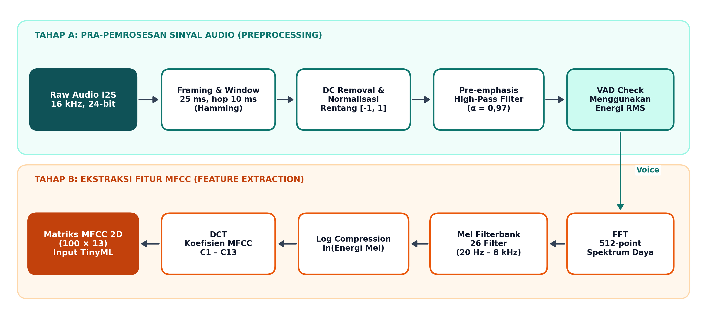
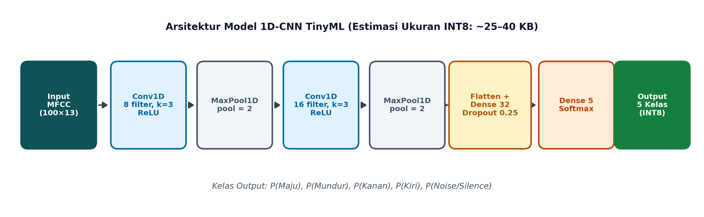
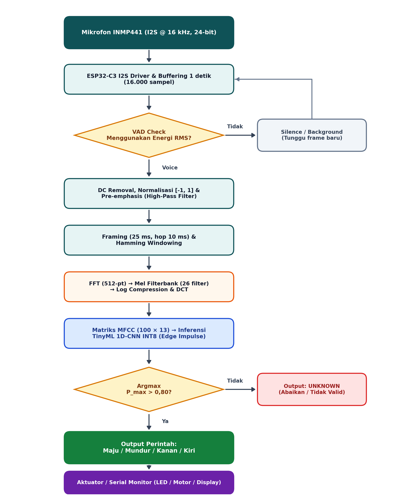

# Edge Voice Command Recognition on ESP32-C3 using TinyML (INMP441 & 1D-CNN)

> **Proyek Akhir Mata Kuliah Instrumentasi Cerdas (PAEI262502)**  
> Program Studi S1 Elektronika dan Instrumentasi, Departemen Ilmu Komputer dan Elektronika  
> Fakultas Matematika dan Ilmu Pengetahuan Alam, Universitas Gadjah Mada (Gasal 2026/2027)

---

## 📌 Ringkasan Proyek
Proyek ini mengimplementasikan sistem pengenalan perintah suara (*Keyword Spotting / Voice Command*) secara *real-time* langsung pada mikrokontroler hemat energi **ESP32-C3** (*Edge AI / TinyML*). Sistem menerima masukan audio digital dari mikrofon **INMP441 (I2S)**, memproses sinyal suara dengan ekstraksi fitur **MFCC (Mel-Frequency Cepstral Coefficients)**, dan mengklasifikasikan ke dalam 5 kelas perintah (*"Maju"*, *"Mundur"*, *"Kanan"*, *"Kiri"*, dan *"Noise/Silence"*) menggunakan model **1D-CNN INT8**. Performa sistem dikomparasikan secara langsung terhadap *Cloud-based Speech Recognition API*.

---

## 👥 Anggota Kelompok
1. **Aditya Rahman**
2. **Jatmika Farandy Salim**
3. **Muhammad Shirajuddin Rory**
4. **Muhammad Irfan Permana Putra**
5. **Rafi Fadil Nugroho**

---

## 🏗️ Arsitektur Sistem & Diagram

### 1. Alur Preprocessing & Ekstraksi Fitur MFCC


### 2. Arsitektur Model TinyML 1D-CNN


### 3. Flowchart Sistem Keseluruhan


---

## 📂 Struktur Direktori

```text
PROYEK INCER/
├── gambar/
│   ├── 01_Alur_Preprocessing_MFCC.png
│   ├── 02_Arsitektur_1D_CNN_TinyML.png
│   └── 03_Flowchart_Sistem_EdgeVoiceCommand.png
├── Laporan_Rancangan_Sistem_EdgeVoiceCommand.docx    <- Laporan lengkap format Word
├── Laporan_Rancangan_Sistem_EdgeVoiceCommand.pdf     <- Laporan siap cetak / unggah
├── Laporan_Rancangan_Sistem_EdgeVoiceCommand.md      <- Draf teks Markdown
└── README.md                                         <- Dokumentasi repositori
```

---

## ⚙️ Spesifikasi Perangkat Keras & Parameter
* **Mikrokontroler:** ESP32-C3 (Single-Core RISC-V @ 160 MHz, 400 KB SRAM, 4 MB Flash)
* **Sensor Audio:** INMP441 Digital Microphone via I2S
* **Sampling Rate:** 16.000 Hz, 24-bit PCM mono
* **Preprocessing:** DC Offset Removal, Pre-emphasis ($y(n) = x'(n) - 0.97 \cdot x'(n-1)$), VAD berbasis RMS
* **Ukuran Frame MFCC:** 25 ms (~400 sampel), Hop length 10 ms (~160 sampel), 26 Mel-bank, 13 koefisien
* **Arsitektur Model:** 1D-CNN INT8 Quantized (Edge Impulse / TFLite Micro) ~30 KB RAM
* **Validasi Dataset:** *Subject-Wise Split* dengan `GroupKFold` untuk mencegah *data leakage*

---

## 📊 Metrik Evaluasi
1. **Confusion Matrix (5 × 5):** Evaluasi akurasi, precision, recall, dan F1-score multi-kelas.
2. **Benchmarking Edge vs Cloud:** Membandingkan latensi inferensi (<100 ms di ESP32 vs ~650 ms di Cloud) dan kestabilan tanpa internet.
3. **Metrologi & Ketidakpastian Pengukuran (GUM):** Evaluasi ketidakpastian Tipe A dan Tipe B dengan faktor cakupan $k=2$.
